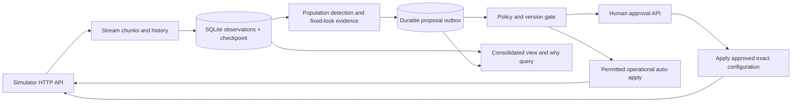

# Outcome-First Agent Loop — Submission

**Project:** Outcome Ledger · **Name:** Debamalya Gupta · **Date:** 8 November 2026 · **Hours actually spent:** 3 **Language / storage:** Python 3.10 / SQLite WAL · **Github:** debgupta-9 · **Email:** debamalya1@gmail.com

## 0. TL;DR
HTTP-only observations, restartable SQLite ingestion, an approval outbox, bounded voice exploration, caller-ID quarantine, and validated prompt repair.
Public_01/02 aggregate conclusion-rate lift: +1.3% / +6.7% in the provided grader; zero changes classified as harmful in either final run.
The after-apply hard-stop/restart test completed with matching event checkpoints and no duplicate applications.
Call-time optimization, welcome-message interactions, learned segmentation, and a tenant-fair scheduler are deliberately cut.
Windows/Bash execution is verified; the exact Linux deployment environment is not.

## 1. Assumptions
1. The HTTP API and observed workflow policy are authoritative. No controller module imports `sim`, opens simulator run files, or parses scenarios.
2. The controller is the only clock-advance writer. Production's real-time arrival behavior must be measured separately.
3. A controller restart keeps the simulator world alive. A new world requires a new database. Default filenames use URL and scenario, with clock/event regression detection; the API supplies no immutable world identity.
4. Workflow IDs are globally unique as returned by the API. No learning or configuration is transferred between workflows.
5. Call timestamps include a timezone; policy hours are IST. The controller polls hourly, so incident observation has up to one simulated hour of scheduling delay before sampling and approval latency.
6. Historical QA and caller-ID observations are useful references, not ground truth. The QA detector has false positives and negatives.
7. Experiments initially target the existing `default` cohort. Existing named cohorts and their effective voice allocations are preserved.
8. Call-level normal approximations are usable at the chosen sample floors. Repeated people can violate independence: nominal error bounds are not a proof of clustered, production false-winner control.
9. SQLite is appropriate for one local writer on persistent disk. Its WAL and database must share durable storage. Multiple active writers are blocked by an OS lock.
10. Approval IDs identify simulated authorization. The API does not expose a named human's legal identity or deliver real client notifications.

## 2. Scope decisions
| # | Capability | Built / Partial / Cut | Why | What it would take to finish |
|---|---|---|---|---|
| C1 | Restartable, idempotent ingestion | Built | Required foundation; bounded streaming and atomic checkpoints | Partition and benchmark ingestion across multiple writers |
| C2 | Feature joins and shared cohorts | Partial | Leads and call facts join by lead ID; API cohort definitions are shared with the view; no learned segmentation | Cohort generation, attribution, and subgroup harm tests |
| C3 | History bootstrap | Built | QA/caller baselines and observed safe prompt fallback | Time-stratified and drift-aware priors |
| C4 | Call-time optimization | Cut | A global hour weight does not change who is selected when everyone gets the same weight; useful timing needs segmentation or per-person evidence | Separate cohort/person study without changing cadence or windows |
| C5 | Caller-ID health | Partial | Evidence-based default-allocation quarantine | Recovery probes, cohort-specific detection, and safe re-entry |
| C6 | Welcome × voice experiments | Partial | Voice only; conservative traffic budget and corrected comparisons | Factorial interaction design and larger samples |
| C7 | Promotion, decay, rollback | Built mechanism | Retained control and a governed rollback path; covered by a deterministic decay test | Broader scenario demonstration and faster calibrated sequential checks |
| C8 | Hallucination response | Partial | Detection, validation, approval, and post-apply checks; LLM fallback when history offers no validated fix | Automated alternative search following a post-fix performance alert |
| C9 | Governance lifecycle | Partial | Durable intents, reconciliation, expiry/lapse/stale paths, caps, hours, and policy checks | Cross-change batching and proactive latency/TTL forecasting, especially late incidents |
| C10 | Honest impact and dry run | Partial | Explicit observed counts, estimated population, actual config diff, and missing-estimate labels | A calibrated counterfactual replay model |
| C11 | Consolidated supervisor view | Partial | One CLI JSON view of config, cohorts, experiments, incidents, approvals, and decisions | Authenticated, accessible product UI |
| C12 | Queryable audit store | Built | Own SQLite records explain controller and observed supervisor changes | Production retention, integrity signing, and access controls |
| C13 | Crash recovery | Built | Hard exit after remote apply and restart; transaction and lost-reply tests | Repeated fault injection at every network/persistence boundary |
| C14 | Loop observability | Partial | Ingest throughput, loop latency, memory, credits, and actionable audit alerts | Exported metrics and a real pager integration |
| C15 | Tenant-fair credits/attention | Partial | Per-workflow caps and global credit reserve prevent one workflow consuming everything | Explicit tenant quotas and a fair scheduler |

I chose to make observations, authorization, and restart behavior dependable before adding optimization dimensions. A learned change is useful only if we can reproduce its evidence and explain who allowed it. The narrow experiment scope sacrifices lift and power but keeps the submission reviewable.

## 3. Stakeholders

### 01 — Sales
Accepted: measured business outcomes and compact reporting. Declined: a blended KPI, guaranteed same-day promotion, and cross-client prompt rollout. Wrong policy claims: Kestrel auto-apply excludes prompt/cohort changes and limits distribution shifts; Northwind KYC auto-apply is disabled.

**Reply:** We can show conclusion rate alongside separate pickup and engagement figures. Promotion depends on observed samples, a guardrail, and each workflow's actual policy. Kestrel does not authorize every change, and Northwind KYC currently disables auto-apply. A successful demo elsewhere is not validation for this workflow. Customer-facing experiments and prompt fixes go through client approval. The summit can show measured results and their limitations; I cannot promise an overnight winner before the evidence exists.

### 02 — Northwind Compliance
Accepted: human approvals for customer-facing changes, validation evidence for prompts, auditable variants, and conservative experimentation. Qualification: operational auto-apply exists for renewal timing/caller-ID changes, but KYC disables it. The API exposes approval IDs, not named human identities.

**Reply:** Every customer-facing change will require the workflow's approval path, and prompt changes will carry same-workflow validation evidence. Our store records call variants, configuration versions, reasons, and approval IDs. Renewal policy permits limited operational auto-apply; KYC currently does not, so operational changes there also need approval. I can provide a consolidated history for review. Named-approver identity and real weekly distribution require production integrations beyond this simulator's interface.

### 03 — Platform/SRE
Accepted: crash evidence, idempotency, bounded resource use, and actionable alerts. Chose embedded SQLite locally instead of adding a service. Production would use the existing Postgres estate. The load report distinguishes controller memory, simulator startup, and host conditions.

**Reply:** The controller persists events and checkpoints atomically and records intent before network writes. The recovery script hard-stops it after the server applies a change but before the local receipt is committed, then restarts the same database. No additional stateful service is required locally. I have recorded ingest throughput, processing latency, memory, and wall time. Those measurements describe the actual Windows host; I have not labeled them as a verified Linux deployment. Production needs Postgres-backed partitioning and real monitoring before launch.

### 04 — Kestrel Operations Supervisor
Accepted: no silent overwrite, at most two requests per 24 hours, requests no earlier than 11:00, and advance human authorization for running-campaign changes. These are stricter than the platform policy (four requests; approver hours 10:00–19:00). A material supervisor voice edit freezes further voice experiments for the run. The consolidated view is a CLI, not a finished screen.

**Reply:** Your limits govern our behavior even where the platform permits more. We will ask no earlier than 11:00, keep requests to two per day, and obtain approval before changes on your running campaigns. If you edit a voice, we stop our voice experiment rather than restart it over your choice. Prompt fixes require safety validation and follow-up performance checks. One command consolidates proposals, tests, incidents, and today's changes; turning that into your production screen is a separate step.

### 05 — Product
Accepted: separate KPIs, shared cohort identities, actual observed evidence, explicit proposal metadata, and workflow-local learning. Chose caller-ID health and audit/reliability ahead of per-person timing. Contract correction: `expired` and `rejected` are distinct terminal states; `lapsed` applies to an approved request that missed its apply window.

**Reply:** Pickup and engagement remain separate throughout storage, inference, and reports. The API's cohort IDs are retained in events and the consolidated view. A requested arm contributes no evidence until it actually runs. Expiry closes the old proposal, and any later proposal uses a new ID, current configuration, and refreshed observations; we preserve the distinction from rejection and lapse. Impact scores explicitly represent estimated absolute primary-KPI gain, with zero for an unestimated experiment. Per-person timing and a polished screen are cut from this version.

### 06 — CTO
Accepted: explainability, finite compute, explicit cuts, scale measurement, and operational ownership. No special policy exception is inferred from seniority. Known safe history is tested before spending credits on LLM suggestions.

**Reply:** This version prioritizes durable evidence and safe authorization over a wide feature list. It can explain an applied change from its own database, and the recovery test exercises a remote success with a missing local receipt. We spend credits on a detected population incident, validate a known historical fallback first, and consult the LLM only when another hypothesis is needed. The submission names the optimization dimensions we cut, publishes unfavorable results, and separates local measurements from unverified deployment claims. Production readiness still requires identity, inference, and operational work.

## 4. Architecture



`store.py` owns persistence and normalized call facts; `evidence.py` owns rates, bounds, and policy comparisons; `governance.py` owns the external-write lifecycle; `learning.py` and `incidents.py` own decisions; `engine.py` sequences ingestion, reconciliation, decisions, and clock advance. `__main__.py` provides run/view/why commands.

SQLite stores raw call facts, lead features, aggregate count buckets, committed chunk IDs, experiments, credit reservations, proposals, and append-only decision records. On restart, we fetch outstanding chunks and reconcile remote history before considering supervisor version changes or sending further writes. Processing a chunk and saving its checkpoint are one transaction. Handling an applied proposal and advancing its experiment state are also one transaction.

## 5. The learning loop

- **Counts:** every dial is recorded, including unanswered calls. Pickup is connected/dials, engagement is engaged/connected, and zero denominators produce unavailable rates.
- **Cohorts:** this implementation uses the API's existing definitions and actual event cohort IDs. Voice learning targets `default`; named cohorts' effective voices are explicitly preserved. We do not invent segments from hidden truth.
- **Exploration:** keep at least 80% incumbent exposure. Remaining voices receive positive dyadic weights (18.75% total alternative exposure with four voices). Exactly representable weights avoid repeated full-config normalization introducing phantom unrelated differences. This is an exposure cap, not a proof that no exploratory call can be harmed.
- **Timing and samples:** one scheduled winner check per day at 11:00 IST, after at least 24 hours of applied traffic. Both primary and guardrail denominator counts must reach 200 in both arms. This is only a floor; narrow confidence bounds often require much more data.
- **Winner selection:** compare observed primary proportions using a normal-approximation difference interval with a half-count variance adjustment. The lower bound must exceed a one-percentage-point practical gain. The guardrail lower bound must stay above the workflow's allowed drop. No LLM makes this decision.
- **Multiplicity:** the comparison budget is workflow count × scenario days × alternative voices × 2, reserving a second family for decay checks. Bonferroni-adjusted two-sided intervals target a nominal 5% family-wise error budget under the approximation/independence assumptions. The seeded independent-null calibration is in `reports/statistics-check.json`; it is not a clustered or complete sequential calibration.
- **Promotion/decay:** a promoted winner receives 80%, with 20% retained incumbent control. Daily checks of up to 48 hours of post-promotion observations can propose rollback when the retained control wins and the guardrail is respected. Rollback itself still needs authorization. No statistically qualified promotion occurred in public_01/02; public_03 produced three governed promotions assessed as beneficial by the grader; a synthetic population test exercises the rollback proposal and proves it is not treated as applied before permission.
- **History:** initial QA/caller baselines and an observed safe prompt are learned from history chunks. History does not fabricate observations for voices that never ran.
- **Two dimensions:** welcome-message and welcome×voice interaction experiments are cut. Caller-ID repair is an operational incident response, not an inferred welcome/voice winner.
- **Guardrail limitations:** call-level dependence and subgroup harm remain risks. Default-cohort average improvement does not prove every person or subgroup benefits. Production requires person-clustered inference and subgroup monitoring.

## 6. Governance

The local lifecycle is `prepared → pending → approved → applied`, with terminal rejected/expired/lapsed/stale/superseded paths. `uncertain` means an HTTP mutation might have committed; it is a reconciliation state, not a reason to generate a new ID immediately. Local `handled` separates a known application from atomic advancement of learning state.

An intent and stable proposal ID are saved before submission. After an uncertain approval request, `/approvals` is searched for that ID. After an uncertain apply, configuration history is searched for the same proposal. An existing remote success is recorded without a second apply. Current base version is checked before any write. Stale full-config intents are closed; later decisions use current settings and refreshed evidence.

Customer-facing changes always use human approvals. Operational auto-apply must pass enabled/dimension/total-variation checks. Kestrel voluntarily uses approval for every change and enforces the stricter client request cap/hours. One active proposal per workflow and incident precedence reduce attention load, but this is not a general cross-change batch planner. Nonurgent requests respect approver hours. Late urgent incidents can still expire overnight because worst-case latency/TTL forecasting is not complete.

Proposal `diff` includes before/after values. `affected_leads` counts observed unconcluded leads in recent campaign days and labels it an estimate, not true dial eligibility; new-campaign-only changes report zero currently affected leads because future uploads are unknown. A dry run carries actual observed counts and policy checks, not a claim of causal counterfactual replay. Impact is estimated absolute primary-KPI gain, clipped to [0,1]; untried voices and safety-only repairs have score zero. Safety incidents are prioritized separately so this honest zero does not make them disappear.

Supervisor edits invalidate pending intents and experiments. A material voice/cohort edit freezes further voice exploration for the run; a prompt edit invalidates mixed-prompt learning and allows safety response. No old full configuration is silently rebased over a supervisor.

## 7. Incidents

QA detection uses the current prompt's last three hours, at least 200 connected calls, an absolute flag rate above 6%, and 99.9% one-sided Wilson bounds separated from history by at least one percentage point. Caller-ID quarantine needs at least 200 recent dials, 400 historical dials, and degradation against both history and at least 200 concurrent alternative dials. These are population thresholds; they do not react to one call. Caller-ID detector correction budgets hourly checks across workflows and scenario days. The QA alert uses a separate 0.1% nominal tail budget for each one-sided bound because it opens validation and human review, not an automatic change. Noisy QA, dependence, and repeated looks preclude a claimed exact global production false-positive rate. The earlier, more conservative QA rule delayed the first incident fix by 1,590 simulated minutes; its report is preserved under reports/initial/public_02-before-alert-calibration.md.

For a prompt incident, validate a historically safe alternative with 600 conversations (six credits). It must achieve at least max(97.5%, policy minimum). If no usable fallback exists, the simulated LLM costs three credits to suggest versions; those proposals still need independent validation. A passing validation says safety, not engagement. After apply, collect at least 200 connections, check QA, and report a large primary regression. Automated alternative search following a performance alert is limited and is a known gap.

Credits are reserved durably before calls. Each workflow has a bounded allowance and eight shared credits are kept in reserve. Saved receipts survive crashes; a missing paid receipt is charged conservatively and never fabricated as validation evidence. This can waste credits after a lost reply, because these two endpoints provide no idempotency or receipt-query API.

Measured public_02 incident timelines from the provided grader:

```json
[
  {
    "type": "did_flagged",
    "workflow": "ks_cancel",
    "at": "D2 10:00",
    "flagged_did_share_by_day": {
      "2": 0.245,
      "3": 0.0,
      "4": 0.0,
      "5": 0.0,
      "6": 0.0,
      "7": 0.0,
      "8": 0.0,
      "9": 0.0
    }
  },
  {
    "type": "supervisor_edit",
    "workflow": "ks_cancel",
    "at": "D3 11:30",
    "mttr_minutes": 390,
    "fixed_by": "controller_approved"
  },
  {
    "type": "supervisor_edit",
    "workflow": "nw_renewal",
    "at": "D5 15:00"
  }
]
```

Final remaining credits: 194.0. The complete incident report is `reports/public_02.md`.

## 8. Scale

| Measurement | Observed value |
|---|---|
| Actual host | Windows-10-10.0.19045-SP0; 4 logical CPUs; 7.88 GiB physical RAM |
| Live parse/SQL throughput before COMMIT | 35,689 events/sec (4,200,082 events) |
| History parse/SQL throughput before COMMIT | 34,206 events/sec (5,537,379 events) |
| Complete-loop replay throughput | 11,956 events/sec; includes simulation/API/commit/decision time |
| Peak controller RSS | 180.2 MiB; excludes simulator/OS |
| Maximum measured decision phase | 1.231 seconds |
| Maximum measured full loop tick | 309.140 seconds |
| Controller wall time including history ingestion | 814.4 seconds |
| Wall time per simulated day, history amortized | 162.9 seconds/day |
| Simulator history generation before controller start | 278.6 seconds, separately measured |
| Polling delay bound in simulated time | 60 minutes; not a measured production SLO |
| Integrity | 7,433,295 call rows = metric dials; event high-water matches API; no duplicate remote applications |

The controller completed public_03. Per-chunk rates exclude final COMMIT/fsync/checkpoint latency and are labeled accordingly. Conservative complete-loop replay throughput is computed from all ingested events divided by the full controller wall time. Raw measurements are in `reports/public_03-runtime.json`. This is a shared Windows desktop, not the evaluator's verified Linux box; some other validation processes overlapped. Earlier attempts hit a 300-second simulator-startup bound and a severe random-IO slowdown on the SATA HDD. The final run uses a 128 MiB SQLite page cache with WAL/FULL durability and a temporary database on the C: SATA SSD; code and simulator data remain on D:. The protected simulator and scenario are unchanged. The final controller includes the separately tested QA alert calibration. Fact buffers flush at 5,000 rows; the per-chunk aggregate dictionary also depends on distinct keys and should be bounded further for hostile cardinality. At the observed live ingestion rate, 8.5 million events (10× 850k/day) alone would take about 238 seconds to replay, before decisions or API simulation. This is an extrapolation, not a measured 10× run.

At 10×, a single synchronous loop and repeated workflow/window scans become the first architectural limits. Normalized call storage and SQLite indexes grow continuously; retention and disk IO become important even though batches bound process memory. Partition by tenant/workflow with one writer/decision owner per workflow; move durable observations, proposal outbox, and leases into the existing Postgres estate with time partitioning. Keep cohort definitions and policy versioning shared. Do not introduce another service before profiling requires it.

## 9. Reliability

`scripts/evaluate.py --scenario scenarios/public_01_dev.yaml --name crash_recovery_final --crash after-apply --no-grade` exercises a hard `os._exit(91)` immediately after the server reports apply success and before the local receipt is committed. Restart uses the same database and still-running world. The recovery JSON captures the remotely applied proposal that was still active locally, final ledger equality, matching event high-water mark, and no duplicate remote applications.

Chunk rollback is tested after 5,001 events, ensuring the test crosses an actual batch flush. Replays do not double-count, and reopened stores preserve progress. Approval tests cover lost apply replies, a later supervisor version, stricter client hours, policy dimensions, and distribution shifts. A saved paid receipt is recovered without another validation charge.

GETs have four bounded attempts. Business 4xx errors are not retried blindly. Stale/expired/lapsed outcomes are persisted; 5xx or transport failure on writes yields uncertainty and reconciliation. A pending clock-advance intent is saved, and the server clock is checked before proceeding after response loss. The clock endpoint has no idempotency key; an advance still in progress causes a stop rather than a guessed second advance. The hard-stop test is one demonstrated point, not an exhaustive proof for every possible network interleaving.

## 10. Audit & observability

```sh
python -m controller why --db state/public_02-4916810e80.sqlite3 --workflow ks_cancel --at 2027-01-07T18:00:00+05:30
```

Actual output excerpt (complete output in `reports/audit-example.json`):

```json
{
  "workflow": "ks_cancel",
  "time_utc": "2027-01-07T12:30:00+00:00",
  "decision": {
    "proposal_id": "df34c6d8-6ab1-4d36-b0fe-cfc11effc6e0",
    "approval_id": "apr_00004",
    "version": 5,
    "kind": "incident",
    "reason": "Restore a validated grounded prompt after population QA degradation"
  },
  "observed_next_six_hours": {
    "arm": "",
    "dials": 1200,
    "connected": 261,
    "engaged": 130,
    "hallucinations": 4,
    "pickup_rate": 0.2175,
    "engagement_rate": 0.49808429118773945,
    "limitation": "Descriptive follow-up; not a causal estimate"
  }
}
```

The consolidated `view` includes policy, current configuration, canonical cohort definitions, experiments, incidents, proposals, and recent decisions. Metrics report per-chunk streaming/parse/SQL throughput before COMMIT, plus complete-loop replay throughput including all commit and simulation time, maximum decision processing seconds, maximum full tick seconds, OS peak controller RSS, and credit availability/reservations. The 60-minute polling interval is a simulated-lag bound, not a measured production ingestion SLO. Decision volume can be queried from `audit` by kind and time rather than confused with loop ticks.

Production page candidates: an unresolved population safety incident with no validated fix; a blocked credit budget during an incident; a sustained ingestion/checkpoint stall; repeated uncertain writes requiring operator reconciliation. The message must include workflow, checkpoint/proposal, evidence, and the next action. A rejected experiment, insufficient samples, and a healthy unchanged workflow belong in the consolidated queue, not the pager. This version stores actionable alert records; it does not send real pages or client messages.

## 11. Results

### public_01_dev

| workflow | conclusion rate | Δ | pickup | Δ | engagement | Δ | engagement gap captured | hallucinated calls (base) |
|---|---|---|---|---|---|---|---|---|
| ks_cancel | 0.348 | +4.6% | 0.242 | +1.5% | 0.503 | +2.4% | 4% | 58 (47) |
| nw_kyc | 0.363 | -0.2% | 0.238 | -1.6% | 0.600 | +1.6% | 0% | 20 (21) |
| nw_renewal | 0.414 | -1.4% | 0.260 | -1.4% | 0.548 | +0.4% | 0% | 44 (42) |
| ALL | 0.373 | +1.3% | 0.247 | -0.2% | 0.537 | +1.4% | 1% | 122 (110) |

### public_02_incidents

| workflow | conclusion rate | Δ | pickup | Δ | engagement | Δ | engagement gap captured | hallucinated calls (base) |
|---|---|---|---|---|---|---|---|---|
| ks_cancel | 0.287 | +15.9% | 0.202 | +9.9% | 0.493 | +3.5% | 28% | 85 (330) |
| nw_kyc | 0.377 | +0.5% | 0.242 | -0.0% | 0.597 | +0.8% | 0% | 33 (31) |
| nw_renewal | 0.439 | +3.0% | 0.262 | -0.1% | 0.561 | +2.3% | 4% | 50 (55) |
| ALL | 0.357 | +6.7% | 0.230 | +3.7% | 0.541 | +2.0% | 13% | 168 (416) |

The final public_01/02 grader classified no applied change as harmful, but the tables still show individual workflow declines. Those observations must not be erased: a single baseline comparison is not a causal explanation of every workflow's change. KYC received no optimization in these runs. Broader replication and subgroup analysis are needed before production claims.

The initial integrated experiment's reports remain under `reports/initial/`. Its incident run flagged two harmful exploratory changes. We reduced unknown exposure and froze supervisor voice ownership rather than weakening significance or guardrail thresholds. The bounded-exposure intermediate run gave up some headline lift (+4.5% aggregate conclusion versus +6.9% initially in public_02) for lower observed change risk. A subsequent QA alert calibration addresses the excessive incident delay separately from winner selection. Neither number is a generalization guarantee on hidden scenarios.

## 12. Trade-offs & rejected alternatives
| Option | Why considered | Why rejected / what instead |
|---|---|---|
| In-memory only | Minimal code and fast updates | Cannot survive a kill; use transactional SQLite |
| New database/queue service | Multi-writer scaling | Adds operations for this local box; design a Postgres migration |
| Full welcome×voice factorial | Captures interactions | Fragments a short run; voice-only scoped experiment |
| Per-person timing now | Stable person IDs make it plausible | Requires reliable eligibility joins and power; explicitly cut |
| Every-iteration winner checks | Fast-looking response | Multiple looks inflate false positives; fixed daily checks and correction |
| Always ask the LLM | Convenient new prompt hypotheses | Validate observed safe history first; spend credits on a detected incident |
| 100% winner allocation | Maximizes immediate exploitation | Loses a control for decay detection; retain 20% incumbent |
| Force a winner in eight days | Better demo narrative | Insufficient evidence is a valid outcome; do not manufacture certainty |

## 13. Known weaknesses
Default-cohort inference can miss heterogeneous effects and subgroup harm. Repeated-person dependence is not modeled by the nominal normal intervals. The null calibration covers independent fixed-look pairs, not clustered full trajectories. Caller quarantine lacks recovery exploration. The supervisor view is CLI JSON. Dry runs are observational, and affected-lead counts are approximate. A post-fix performance alert does not guarantee an automated alternative search. Urgent overnight TTL forecasting and cross-change batching are incomplete. Credit caps are per workflow, not tenant-fair scheduling. SQLite has one writer and no retention policy. Human names, true run IDs, real-time event brokers, auth, PII controls, external paging, and client delivery are absent from the simulator integration. Linux execution on the evaluator's machine remains unverified. No benchmark is presented as an uncontended production guarantee.

## 14. If this went to production at Formi next month
1. Days 1–2: run in read-only shadow mode, define real outcome/guardrail SLOs, and bind every event, policy, and write to immutable tenant/workflow/run identity. Integrate named client authorization and tamper-evident audit retention.
2. Days 3–4: move the durable outbox, ingestion checkpoints, and workflow ownership leases to existing Postgres. Add time partitioning, retention, backup/restore, tenant access controls, PII minimization/encryption, and production authentication. Replay and fault-test realistic late/duplicate events.
3. Days 5–6: validate person-clustered inference, QA calibration, delayed outcomes, subgroup harm, practical sample sizes, sequential stopping, and decay monitoring with an independent statistics review.
4. Days 7–8: implement tenant-fair credit/attention budgets, approver-latency forecasts, batching, and an authenticated supervisor screen with clear estimates and unknowns. Add exported loop metrics and tested actionable pages.
5. Days 9–10: rehearse incident/rollback/recovery runbooks on target Linux hardware, then launch a small client-approved canary with explicit stop criteria. Expand only after operational and statistical evidence supports it.
